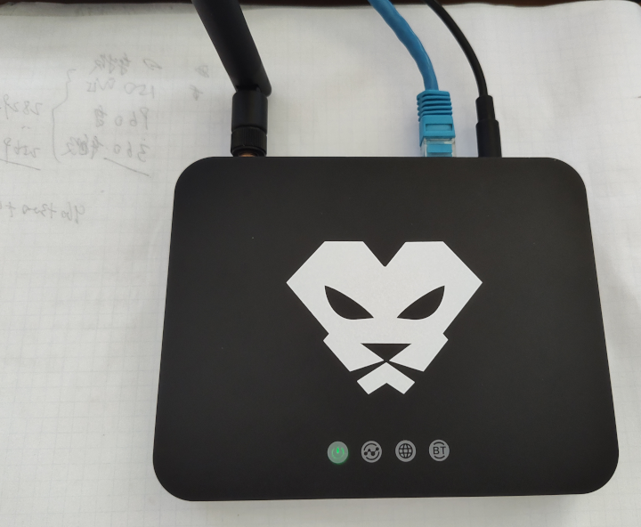
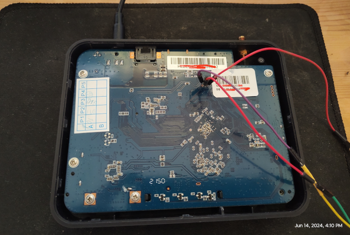
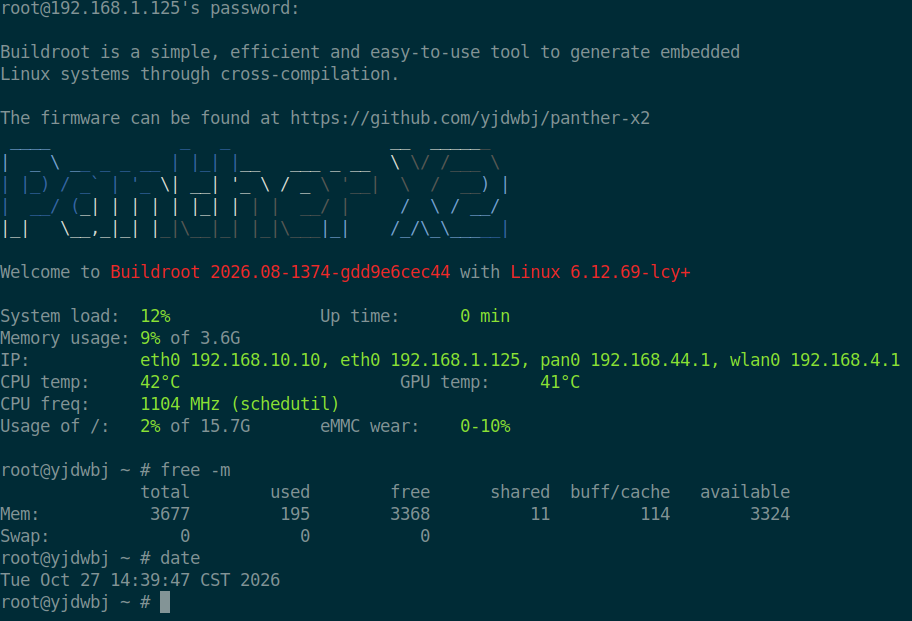
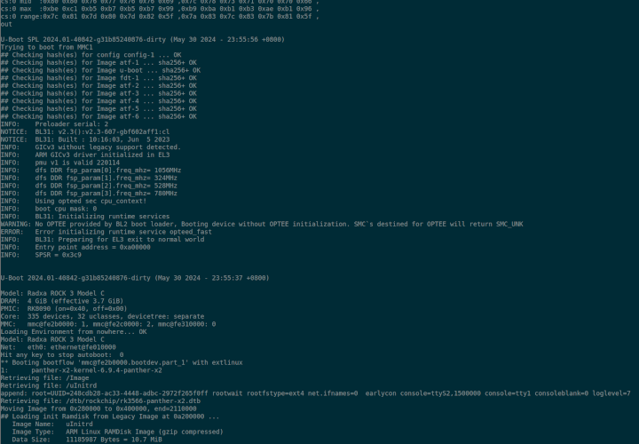
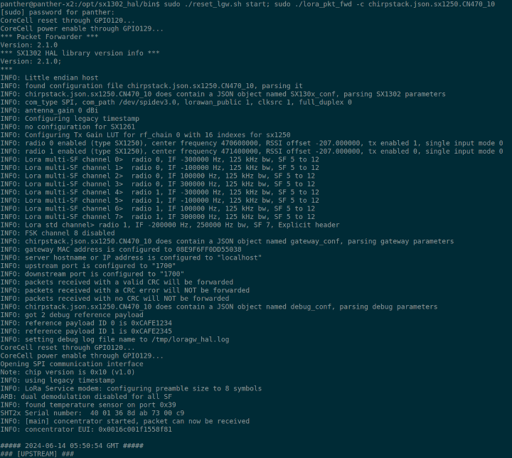

# Panther X2

## Product Introduction

The [Panther X2](https://panther.global) was sold as a Helium LoRaWAN hotspot: a quad-core RK3566 box with
an SX1302 LoRa concentrator, Wi-Fi/Bluetooth, Gigabit Ethernet and an ATECC608 crypto chip. This repository
turns it into a general-purpose Linux board: a small **Buildroot** system on a Rockchip BSP **6.12** kernel
that drives all of its hardware, plus a hardware-accelerated **camera / WebRTC / NPU** pipeline and a
**LoRa** gateway, a **Bluetooth** console and network, and an MQTT bridge into a small home
hub (Zigbee, LoRaWAN server, Home Assistant) on a PC.

## Features and Specifications

|Hardware Specification||
|----|----|
|SoC        |●Rockchip RK3566, quad-core Cortex-A55 up to 1.8 GHz<br>●NPU 0.8 TOPS, VPU (JPEG decode, H.264/H.265 encode), RGA2|
|Memory     |●4 GB|
|Storage    |●eMMC 32 GB (HS200) + TF card slot|
|PMIC       |●RK809 + TCS4525 (vdd_cpu)|
|LoRa radio |●SX1302 + SX1250 on SPI3, external SMA antenna<br>●EU868 (PN 980-900-0985R) and US915 variants|
|Wi-Fi radio|●AP6212A (BCM43430A1), 2.4 GHz 802.11 b/g/n, SDIO, built-in antenna|
|BLE radio  |●AP6212A (BCM43430A1), UART|
|Crypto chip|●Microchip ATECC608A on i2c-1 (0x60)|
|LAN        |●RJ45 1 Gbps, RTL8211F (RGMII)|
|USB        |●USB-A 2.0 (RK3566 DWC3 OTG port): host for a UVC camera, or gadget (adb / serial / NCM / mass storage)|
|LEDs       |●4 green LEDs: power, connection, globe, BT|
|Button     |●Push-button on SARADC channel 0 (Loader mode)|
|Power      |●DC jack, DC 12 V 1~1.5 A|




Serial console: `ttyS2`, **1500000 8N1**.
The default username is **root** ,and the password is **2026px2**. Here is the full [dmesg](dmesg.log)

## Releases

* **Current**: [Buildroot 2026.08](https://buildroot.org) + Linux **6.12.69** (Armbian
  [linux-rockchip](https://github.com/armbian/linux-rockchip) `rk-6.12-rkr1`, Rockchip BSP) +
  Rockchip U-Boot (`next-dev`), FIT `boot.img`, flashed with the Rockchip tools (RKFW).
* Previous: [U-Boot 2024.01 + Kernel 6.9.4 + Debian 12](#previous-release-debian-12--kernel-694).

## Status

| Hardware / function | Status | Notes |
|---|---|---|
| Ethernet (RTL8211F) | ok | 1 Gbps, DHCP + fixed `192.168.10.10` |
| Wi-Fi (brcmfmac 43430) | ok | **access point** (hostapd) tested; station via wpa_supplicant |
| Bluetooth (BCM43430A1) | ok | AP6212A patch `BCM43430A1.panther,x2.hcd` |
| USB host + UVC camera | ok | MJPEG up to 2592x1944@30 |
| USB gadget (OTG) | in progress | `usb-mode device adb\|acm\|ncm\|msc` |
| VPU: JPEG decode, H.264 encode, RGA | ok | ffmpeg-rockchip, zero-copy |
| NPU (RKNPU 0.9.8, librknnrt 2.5.0) | ok | YOLOv8n 28 ms / 35 FPS |
| SX1302 LoRa concentrator | ok | receive verified with ChirpStack Concentratord + MQTT Forwarder; `lora-tx` for raw TX |
| ATECC608A | ok | serial number and configuration read; P-256 sign/verify available (atecc-util) |
| LEDs, button, RTC, cpufreq, thermal | ok | |

## What's inside


| Integrated                         | Notes                                           |
| ---------------------------------- | ----------------------------------------------- |
| rknpu2                             | RKNN runtime librknnrt 2.5.0 (+ rknn_server)    |
| rockchip-mpp                       | Rockchip MPP 1.1.0                              |
| rockchip-librga                    | librga 1.10.6                                   |
| ffmpeg-rockchip                    | FFmpeg 8.1 + rkmpp/rkrga (+ optional drawtext)  |
| mediamtx-bin                       | MediaMTX 1.21.2 (WebRTC / RTSP / HLS)           |
| px2-detect                         | person (NPU) + motion detector for recording    |
| chirpstack-concentratord           | SX1302 Concentratord 4.7.1 + Panther X2 pin map |
| chirpstack-mqtt-forwarder          | MQTT Forwarder 4.6.1 (JSON, local mosquitto)    |
| atecc-util, figlet, reboot-loader, | Misc                                            |


## Building

## Partitions and flashing

`parameter.txt` (GPT, 512-byte sectors):

| Partition | Size | Content |
|---|---|---|
| uboot | 4 MB | U-Boot (FIT) |
| boot | 64 MB | FIT `boot.img`: kernel + DTB; `bootargs` come from the DTS `/chosen` node |
| udisk | 4 GB | FAT32 `PX2DISK`, exported as a USB disk in gadget mode, `/mnt/udisk` |
| rootfs | 16 GB | ext4, `root=PARTUUID=614e0000-0000-4b53-8000-1d28000054a9` |
| userdata | rest | ext4, `/data` (created and grown on first boot) |

Enter **Loader (rockusb) mode** for [upgrade_tool](upgrade_tool):

* `reboot-loader` from a shell (works over SSH as well), or
* hold the button for 5 s while Linux runs, or hold it while powering on (U-Boot).

## What runs on the board





| Function | What |
|---|---|
| Dynamic login message | dynamic login message (BusyBox ash): load, memory, IPs, temperatures, CPU frequency, disks, eMMC wear from the JEDEC `life_time` registers |
| Resizefs | first boot: grows the rootfs and `userdata` to the real eMMC / SD size, mounts `/data` |
| Udisk | FAT32 `udisk` partition on `/mnt/udisk` |
| Support Host and Device mode | `usb-mode host` / `usb-mode device adb acm ncm msc` / `usb-mode status` |
| LEDs controel | LEDs via kernel triggers: connection = wlan0, globe = eth0, BT = `hci0-power`; power = heartbeat (DTS) |
| NTPD | BusyBox ntpd; the time is written back to the RK809 RTC after each sync |
| SSH | closes SSH sessions before the network goes down at reboot |
| Hostpd | Wi-Fi access point `PantherX2` on 192.168.4.1 with DHCP (dnsmasq or udhcpd) |
| Mediamtx | camera streaming and activity detection (below) |
| Enter Loader mode | Loader mode from the button or the shell |

## Camera: UVC -> hardware H.264 -> WebRTC

```
UVC MJPEG -> mjpeg_rkmpp (jpegd) -> RGA (scale / rotate, NV12) -> h264_rkmpp (rkvenc) -> mediamtx -> WebRTC / RTSP / HLS
```

The whole chain runs in DMA buffers (`drm_prime`); the CPU only moves packets. At 1280x720 with
everything running the SoC stays around 45~50 °C without a fan.

```sh
cam-h264 -t 10 /tmp/test.mp4                       # record 10 s
cam-h264 -O -k 1 -p baseline rtsp://127.0.0.1:8554/cam

```

| URL | |
|---|---|
| `http://<board>:8889/cam/` | browser (WebRTC) |
| `rtsp://<board>:8554/cam` | VLC / ffplay / other mediamtx instances |
| `http://<board>:8888/cam/` | HLS |

`grid.html` shows several cameras as a 2x2 / 3x3 grid in a browser or on a phone (WHEP, auto
reconnect, tap to enlarge).

### Audio

Cameras with a microphone appear as a USB Audio interface next to the video one. `-A` finds that
ALSA card through sysfs (same USB device as the video node) and adds an **Opus** track: browsers only
play Opus over WebRTC and mediamtx does not transcode, so the same track serves WebRTC, RTSP and the
recordings. The video gets `-ts mono2abs` so that both tracks use the same clock.

```sh
cam-h264 -A -s 1920x1080 -k 1 -p baseline rtsp://127.0.0.1:8554/cam
AUDIO_RATE=16000 AUDIO_CH=2 cam-h264 -a plughw:CARD=Camera,DEV=0 -t 10 /tmp/av.mp4
```

### Recording only when something happens

The board does not record (eMMC wear). An always-on PC runs mediamtx, pulls the stream and records
1-minute segments; the board decides what is worth keeping:

```
board: mediamtx :8554/cam -+-> PC mediamtx (records 1-minute fMP4 segments)
                           +-> ffmpeg (1 key frame/s) | px2-detect
                                 YOLOv8n "person" on the NPU + motion on the CPU
                                 -> /run/px2-detect/events.jsonl (tmpfs)
```

A segment is only deleted when the detector was provably running (heartbeats) and nothing happened
within the configured margins; while the board, the detector or the transfer are down, everything is
kept.

## Home hub (MQTT, Zigbee, LoRaWAN server, Home Assistant)

The board keeps a local mosquitto (127.0.0.1 only) and **bridges** it to the main broker on the
always-on PC, so the board works on its own when the PC is down and exposes no broker to the LAN.
`minipc/` is a Docker Compose stack for that PC:

```
Panther X2 (local mosquitto)                         PC (docker compose, minipc/)
  chirpstack-mqtt-forwarder  gateway/#        --+     mosquitto :1883 (user + ACL per service)
  px2-mqtt                   px2/#            --+-->    +- ChirpStack v4 :8081 (EU868)
  HA discovery               homeassistant/#  --+ bridge+- zigbee2mqtt :8080 <- CC2652P
                                                        +- Home Assistant :8123 (+ BLE via the PC)
```

* ChirpStack reads the forwarder's JSON (detected per gateway) and topics without a region prefix
  (`topic_prefix=""`), so `lora-rx` / `lora-tx` on the board keep working.
* The board shows up in Home Assistant by itself: *Activity* (occupancy), *Persons*, *Record*
  (60 s of forced activity); `px2/bridge/state` drives its availability.
* `minipc/examples/automations.yaml`: door opens -> keep recording, activity at night -> light on,
  away mode -> notification.

| Topic                                                           | Direction | Content                                       |
| --------------------------------------------------------------- | --------- | --------------------------------------------- |
| `gateway/<id>/event/up\|stats\|ack`, `.../command/down\|config` | both      | LoRa frames, ChirpStack downlinks             |
| `px2/detect/event` / `state` / `status` / `online`              | board ->  | events, `ON`/`OFF`, status.json, availability |
| `px2/detect/trigger`                                            | -> board  | `SECONDS [SOURCE]`: forced activity           |
| `px2/bridge/state`                                              | board ->  | `1` / `0` (bridge last will)                  |

## NPU

```
# ./rknn_benchmark yolov8n.rknn "" 50
rknn_api/rknnrt version: 2.5.0, driver version: 0.9.8
total dma used size: 11210752
Avg Time 28.43ms, Avg FPS = 35.174
```

Models are converted on a PC with [rknn-toolkit2](https://github.com/airockchip/rknn-toolkit2) 2.5.0
(same version as the runtime) from the [rknn_model_zoo](https://github.com/airockchip/rknn_model_zoo)
ONNX files, target `rk3566`, `i8`. Here is the full [benchmark log](rknn_benchmark.log)

## LoRa (SX1302)

```
SX1302 --SPI--> chirpstack-concentratord-sx1302 --ZeroMQ--> \ chirpstack-mqtt-forwarder --MQTT/JSON--> mosquitto
```

Panther X2 wiring: `/dev/spidev3.0`, reset GPIO3_D0 (gpiochip3 line 24), power GPIO4_A1
(gpiochip4 line 1). The board has no concentrator temperature sensor, so
`Get concentrator temperature error` in the log is expected.

```sh
lora-rx                                   # every frame, LoRaWAN or raw LoRa
lora-tx -f 868.1 -s 7 -p 5 "ping"         # transmit a raw frame now (normal IQ)
```

```
TIME     GATEWAY               MHZ SF/BW      RSSI   SNR CRC    PAYLOAD
19:46:57 0016c001f1112db9    868.5 SF9/125k    -50  9.75 OK     ..........S..~.pa..{_.
19:47:38 0016c001f1112db9    868.3 SF9/125k    -51 11.25 OK     ..........S..~.p._<N.
```

A Heltec WiFi LoRa 32 V4 (ESP32-S3 + SX1262) point-to-point test firmware for ESP-IDF + RadioLib is
in `heltec-v4-p2p/`.

## Wi-Fi and Bluetooth

```
Bluetooth: hci0: BCM43438A1 26MHz AP6212A1_CL1 BT4.0 OTP-BD-0034
Bluetooth: hci0: BCM43430A1 (001.002.009) build 0106
brcmfmac: Firmware: BCM43430/1 wl0: Jul 19 2021 03:24:18 version 7.45.98 (TOB) (56df937 CY)
```

The AP6212A module needs its own files:

* `brcm/BCM43430A1.panther,x2.hcd`: the Raspberry Pi patch makes the controller hang
  (`0xfc18` timeout);
* `brcm/brcmfmac43430-sdio.panther,x2.txt`: the AP6212 nvram. The generic
  `brcmfmac43430-sdio.txt` in linux-firmware is the Raspberry Pi one with `xtalfreq=37400`, but
  the AP6212A has a **26 MHz** crystal: Wi-Fi seems to work, yet the radio is off frequency and an
  access point is never seen.

### Bluetooth console and network

Maintenance access without Ethernet or Wi-Fi (`bt-console`, `/etc/default/bt-console`):

* **serial console** (SPP / RFCOMM channel 1): a `login:` like `ttyS2`, from Linux
  (`rfcomm connect hci0 <MAC> 1`), Windows (outgoing COM port + PuTTY) or Android (Serial
  Bluetooth Terminal). iPhones have no SPP.
* **network** (PAN / NAP): clients join bridge `pan0` and get an address by DHCP, then
  `ssh root@192.168.44.1`. No gateway is handed out unless `PAN_ROUTER=1` (internet through `S45nat`).
* Only paired devices connect (authenticated + encrypted links). `bt-console pair` opens a 120 s
  window in which any pairing is accepted, then trusts the new devices.

```sh
bt-console pair            # board: discoverable + pairable for 120 s (name PX2-xxxx)
bt-console status          # paired devices, PAN clients, DHCP leases
```

## ATECC608A

```sh
~$ atecc -b 1 -c serial
01237b80be52530fee
```

Config and data zones were locked by Helium. Slots 0-6 and 8-15 hold P-256 private keys usable for
signing and ECDH and may be regenerated with GenKey; slot 0 is the original Helium identity, slot 7
is a limited-use key. Useful for a device identity and signed data.

## Previous release (Debian 12 + Kernel 6.9.4)

U-Boot 2024.01, mainline kernel 6.9.4 and Debian 12 (bookworm) booting from a uSD card:
[v1.0](https://github.com/yjdwbj/panther-x2/archive/refs/tags/v1.0.tar.gz).



Benchmarks from that release: 7-Zip `7zr b` total rating **4480 MIPS**; OpenSSL 3.0
(ARMv8 crypto extensions) AES-128-CBC ~1.3 GB/s, AES-128-GCM ~870 MB/s, SHA-256 ~730 MB/s
(16 KB blocks).



## Credits

I would like to thank the Kali-ARM and Armbian projects for inspiring me, and the
[Buildroot](https://buildroot.org), [ChirpStack](https://www.chirpstack.io),
[MediaMTX](https://github.com/bluenviron/mediamtx),
[ffmpeg-rockchip](https://github.com/nyanmisaka/ffmpeg-rockchip),
[Rockchip rknn-toolkit2 / rknn_model_zoo](https://github.com/airockchip) and
[RadioLib](https://github.com/jgromes/RadioLib) projects.

## Star History

[](https://star-history.com/#yjdwbj/panther-x2&Date)
